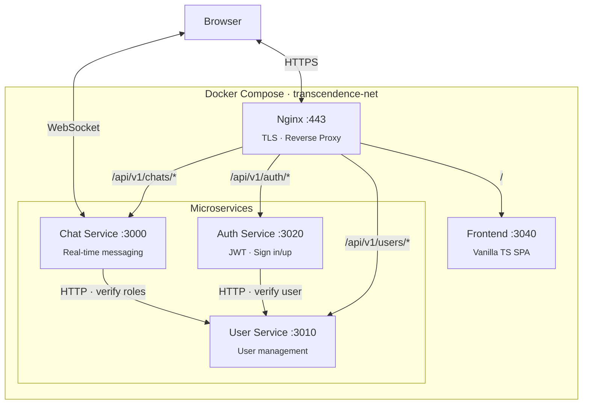
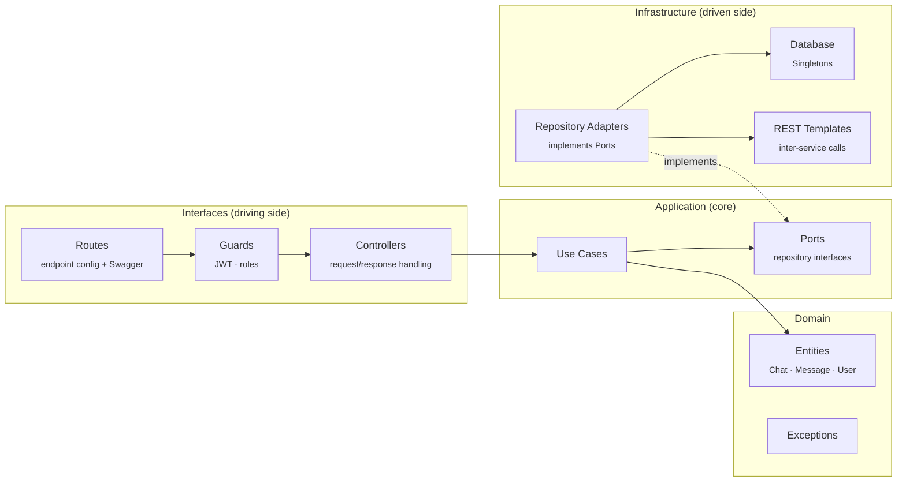

# Trascendence

Full-stack web platform built with **TypeScript**, **Fastify 5**, and a **microservices architecture**. Features real-time chat via WebSocket, JWT authentication, and a vanilla TypeScript SPA — all containerized with Docker Compose behind an Nginx reverse proxy with TLS.

> 42 School project — building a complete web application from scratch without using mainstream frontend frameworks.

## Architecture



## Hexagonal Architecture (Ports & Adapters)

All three backend services follow the same **hexagonal architecture** with SOLID principles:



```
service/
├── interfaces/
│   ├── routes/          # Endpoint config, HTTP method, Swagger schema
│   ├── guards/          # JWT verification, role filtering, cookie handling
│   └── controllers/     # Request parsing → use case → response formatting
├── application/
│   ├── use-cases/       # Business logic (one class per action)
│   └── ports/           # Repository interfaces (Port does not know Adapter)
├── domain/
│   ├── entities/        # Core data models (Chat, Message, User)
│   └── exception/       # Custom error handling
└── infrastructure/
    ├── repositories/    # Adapters implementing Ports
    ├── db/              # Data source connections and singletons
    └── rest/            # HTTP clients for inter-service communication
```

## Services

### Auth Service `:3020`

Handles authentication — sign in, sign up, and session verification.

| Endpoint | Method | Auth | Description |
|---|---|---|---|
| `/api/v1/auth/signin` | POST | — | Login with credentials, returns JWT cookie |
| `/api/v1/auth/signup` | POST | — | Register new user |
| `/api/v1/auth/me` | GET | JWT (role: view) | Verify session and return user info |

- JWT signed with configurable secret, stored as httpOnly cookie
- Passwords hashed with bcrypt
- Delegates user storage to User Service via REST

### User Service `:3010`

User management and profile data.

| Endpoint | Method | Description |
|---|---|---|
| `/api/v1/users` | GET | List all users |
| `/api/v1/users/:userId` | GET | Get user by ID |
| `/api/v1/users/save-user` | POST | Create user |
| `/api/v1/users/:userId` | POST | Update user |

### Chat Service `:3000`

Real-time messaging with WebSocket and REST endpoints.

| Endpoint | Method | Auth | Description |
|---|---|---|---|
| `/api/v1/chats/user/:userId` | GET | JWT | List chats for a user |
| `/api/v1/chats/:chatId` | GET | JWT | Get chat details |
| `/api/v1/chats/:chatId/messages` | GET | JWT | Load messages |
| `/api/v1/chats/connect-ws` | WS | JWT | Real-time messaging |

**Use cases:**
- `ListenMessage` — receive and broadcast messages via WebSocket
- `LoadChat` / `LoadChatByUserId` — retrieve chat history
- `BroadcastConnectionStatus` — notify users of online/offline status
- `CloseSession` / `VerifyConnection` — session lifecycle management

**Role-based access:** every request is verified against User Service through `RoleGuard`.

### Frontend `:3040`

Vanilla **TypeScript SPA** — no React, no Vue, no Angular. Custom component system built from scratch:

- Hash-based routing (`#home`, `#game`, `#stats`, `#profile`, `#chat`)
- Custom `Component` base class for UI composition
- Login and registration flows
- Real-time chat interface via WebSocket
- Statistics page with chart visualization
- Built with **Tailwind CSS 3** for styling

### Nginx

Reverse proxy with TLS termination:

- Routes all `/api/v1/*` paths to the corresponding service
- Serves the frontend at `/`
- Swagger docs accessible at `/docs/auth/`, `/docs/users/`, `/docs/chats/`
- TLS 1.2 with self-signed certificates

## Tech Stack

| Layer | Technology |
|---|---|
| Language | TypeScript (backend + frontend) |
| Runtime | Node.js 18 |
| Framework | Fastify 5 |
| Real-time | WebSocket (@fastify/websocket) |
| Auth | JWT (@fastify/jwt) + bcrypt + httpOnly cookies |
| API Docs | Swagger (@fastify/swagger-ui) |
| Frontend | Vanilla TypeScript SPA + Tailwind CSS 3 |
| Proxy | Nginx with TLS |
| Containers | Docker Compose (5 services + nginx) |
| Architecture | Hexagonal (Ports & Adapters), Microservices |

## Getting Started

### With Docker Compose (recommended)

```bash
docker compose up -d
```

The app will be available at `https://localhost`.

### Local development

Run each service in a separate terminal:

```bash
# Auth Service
cd back-end/auth-service
npm install && npm run dev

# User Service
cd back-end/user-service
npm install && npm run dev

# Chat Service
cd back-end/chat-service
npm install && npm run dev

# Frontend
cd front-end
npm install && npm run dev
```

### API Documentation

Each service exposes Swagger UI:

| Service | Swagger URL |
|---|---|
| Auth | `http://localhost:3020/docs` |
| User | `http://localhost:3010/docs` |
| Chat | `http://localhost:3000/docs` |

## Status

Active development on `develop` branch. Core features (auth, chat, user management) are functional. Game module is in progress.

## License

MIT
